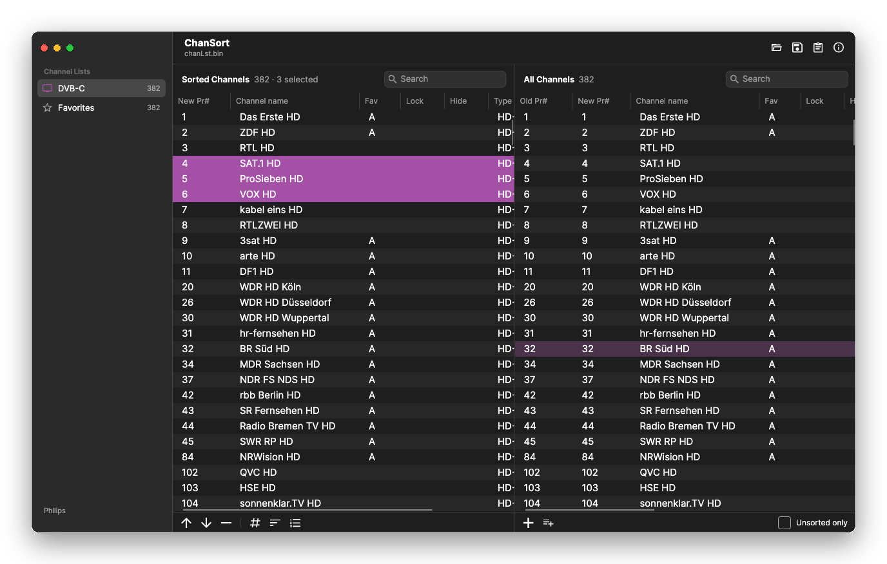
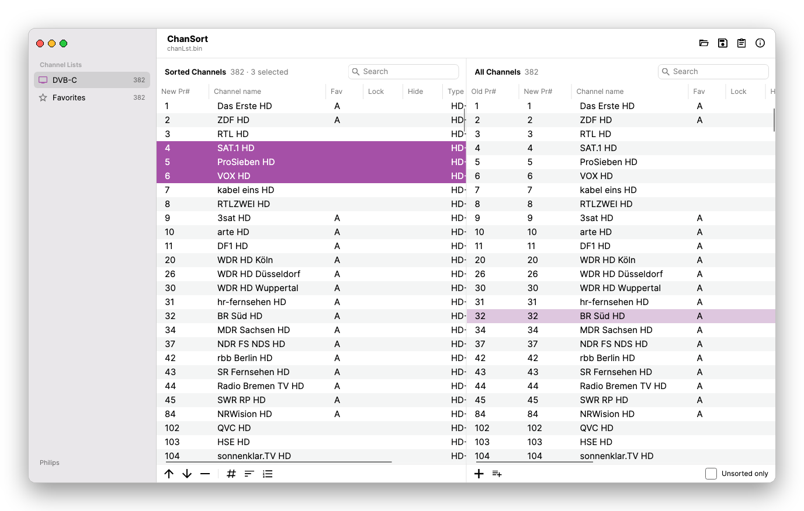
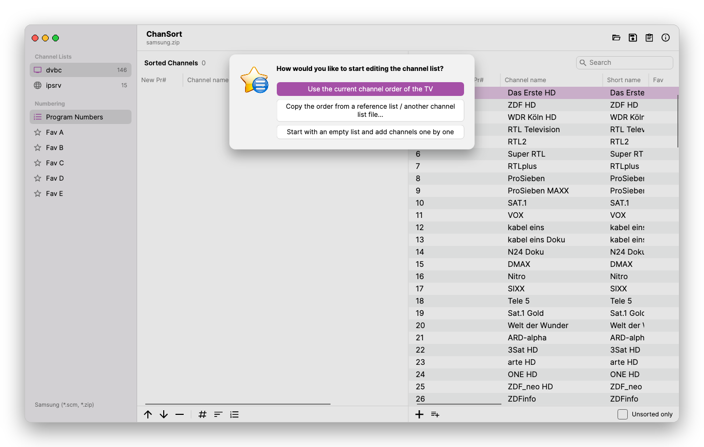

ChanSort for Mac
================
**Reorder your TV's channel list on your Mac.**  
A native macOS app for Apple Silicon and Intel Macs, based on [ChanSort](https://github.com/PredatH0r/ChanSort).

[Download](https://github.com/alfonsocasadodiez/ChanSort-Mac/releases/latest) |
[All releases](https://github.com/alfonsocasadodiez/ChanSort-Mac/releases) |
[Supported TVs](#supported-tv-models) |
[How to use](#how-to-use) |
[Build from source](#build-from-source) |
[License](#license-gplv3)

About
-----
Most modern TVs can export their channel list to a USB stick. ChanSort for Mac opens that file, lets you put the
channels in the order you want, and saves it back so the TV can import it again.
It supports [file formats from numerous brands](#supported-tv-models) and can copy the channel order and favorites
from one file to another, even between different TV models and brands.

Download and installation
-------------------------
**[Download the latest version](https://github.com/alfonsocasadodiez/ChanSort-Mac/releases/latest)**

| Your Mac | File |
|---|---|
| Apple Silicon (M1, M2, M3, M4, …) | `ChanSort_<version>_macOS_AppleSilicon.dmg` |
| Intel | `ChanSort_<version>_macOS_Intel.dmg` |

(Apple menu → About This Mac shows which chip your Mac has. A `.zip` of each version is also available.)

1. Open the .dmg and drag **ChanSort** into your **Applications** folder.
2. The app is not notarized by Apple, so macOS blocks it the first time. To allow it:
   - open it once, then go to **System Settings → Privacy & Security** and click **Open Anyway** (macOS 15 and later), or
   - right-click the app in Applications and choose **Open** (macOS 14 and earlier), or
   - run `xattr -dr com.apple.quarantine /Applications/ChanSort.app` in Terminal.
3. Start ChanSort and open your channel list.

Requires macOS 12 (Monterey) or later. Nothing else needs to be installed.

Features
--------
- **Mac-style window**: a sidebar with your TV's channel lists (TV, radio, satellite, cable, IP, favorites) and
  favorite lists, a unified toolbar, search fields, and button bars below each table; light and dark appearance
  and your system accent color
- **Sorted list and all channels side by side**: add channels with double-click, ↵ or +, remove them with ⌫ or −,
  move them with ⌘↑ / ⌘↓, and type a new number or name directly in the sorted list
- **Set number, sort by name, renumber without gaps, add all unsorted channels**, each with one click,
  on several selected channels at once
- **Favorites, parental lock, skip and hide**, including TVs with separately sorted or mixed-source favorite lists
- **Reference lists**: copy the channel order from another TV's file or from a ChanSort .txt/.csv list
  (17 ready-made lists for common satellite and cable providers are included), and save your own
- **Rename channels**, choose the character set for older TVs, and view details about the loaded file
- Drag & drop files onto the window or the Dock icon, recent files, dialogs as sheets, full keyboard support
- A `.bak` copy of the original file is kept when saving

| Light appearance | Start dialog |
|---|---|
|  |  |

Not supported:
- adding new transponders or channels
- changing tuner related properties of channels (ONID, TSID, SID, frequency, APID, VPID, ...)
- not available in the Mac version yet: drag & drop inside the tables, printing / Excel export,
  the LG "TV settings" dialog, user interface languages other than English

Some features may not be available for all TV models and channel types (analog, digital, sat, cable, ...).

How to use
----------
1. On your TV, export the channel list to a USB stick (look for "copy to USB", "export channel list" or similar
   in the channel or installation settings).
2. Plug the stick into your Mac and open the channel list file in ChanSort (**File → Open** or drag & drop).
3. Choose how to start: keep the TV's current order, copy the order from a reference list, or start with an empty
   list and add channels one by one.
4. Arrange the channels in the **Sorted Channels** table. Channels from **All Channels** are added after the
   channel selected in the sorted list.
5. **Save** (⌘S). If some channels are not in the sorted list, ChanSort asks whether to append, hide or delete them.
6. Import the file on your TV from the USB stick.

Keyboard shortcuts
------------------
| Action | Shortcut |
|---|---|
| Open / Save / Save As | ⌘O / ⌘S / ⇧⌘S |
| Apply reference list | ⌘R |
| File information | ⌘I |
| Add selected channels to the sorted list | ↵ or double-click (in All Channels) |
| Remove from the sorted list | ⌫ (in Sorted Channels) or ⌘⌫ |
| Move up / down | ⌘↑ / ⌘↓ |
| Set number / Rename | ⇧⌘N / ⌘E |
| Add to favorites A…I / remove from favorites | ⌘1…⌘9 / ⇧⌘1…⇧⌘9 |
| Toggle parental lock / skip / hide | ⌘L / ⌘K / ⇧⌘H |
| Switch channel list | ⌥⌘1…⌥⌘9 |

! USE AT YOUR OWN RISK !
------------------------
Most of this software was written without support from TV manufacturers or access to any official
documentation about the file formats. It is solely based on analysing existing data files, trial and error.
There is a chance of unwanted side-effects or even damage to your TV, as reported in 2 cases.
Always keep a copy of your original channel list.

Hisense is the only manufacturer who provided technical information and a test device.

Supported TV models
-------------------
ChanSort supports a large number of file formats, but it's impossible to tell for every brand and TV model
what file format it uses (which may even change with firmware updates).
This list gives some examples of what should be supported, but even if your model or brand is not in this list,
it may work anyway:
- [Samsung](source/fileformats.md#samsung)
- [LG](source/fileformats.md#lg)
- [Sony](source/fileformats.md#sony)
- [Hisense](source/fileformats.md#hisense)
- [Panasonic](source/fileformats.md#panasonic)
- [TCL](source/fileformats.md#tcl)
- [Philips](source/fileformats.md#philips)
- [Sharp, Dyon, Blaupunkt, Hisense, Changhong, Grundig, alphatronics, JTC Genesis, ...](source/fileformats.md#sharp)
- [Toshiba](source/fileformats.md#toshiba)
- [Grundig](source/fileformats.md#grundig)
- [SatcoDX: ITT, Medion, Nabo, ok., PEAQ, Schaub-Lorenz, Silva-Schneider, Telefunken, ...](source/fileformats.md#satcodx)
- [DBM: Xoro, Strong, TechniSat, ...](source/fileformats.md#dbm)
- [Loewe](source/fileformats.md#hisense)
- [Vision Edge 4K](source/fileformats.md#visionedge)
- [VDR](source/fileformats.md#vdr)
- [SAT>IP m3u](source/fileformats.md#m3u)
- [Enigma2](source/fileformats.md#enigma2)

Requirements
------------
- macOS 12 (Monterey) or later, on a Mac with Apple Silicon or an Intel processor
- A USB stick or SD card to transfer the channel list between your TV and your Mac. A stick of 32 GB or less,
  formatted as **MS-DOS (FAT32)** in Disk Utility, is STRONGLY recommended. (Some TVs write garbage to NTFS
  and don't support exFAT at all.)

Troubleshooting
---------------
- If a file can't be opened, make sure it is the file your TV exported (some TVs export several files or a folder;
  see the [supported TV models](#supported-tv-models) for which file to open).
- ChanSort writes a diagnostic log to `~/Library/Logs/ChanSort/ChanSort.log`, which is useful when reporting a problem.
- Settings (recent files, character set, window size) are stored in `~/Library/Application Support/ChanSort/settings.json`.

Build from source
-----------------
Requirements: the [.NET 10 SDK](https://dotnet.microsoft.com/download) (e.g. `brew install dotnet`).

- Run from source: `dotnet run --project source/ChanSort.Avalonia`
- Build the app bundles for Apple Silicon and Intel (.dmg and .zip, written to `source/dist-macos`):
  `source/ChanSort.Avalonia/build-macos.sh [version]`

The Mac app (`source/ChanSort.Avalonia`) uses [Avalonia UI](https://avaloniaui.net/) and the same file format
modules (`source/ChanSort.Loader.*`) as the original ChanSort. See [build.md](source/build.md) for more details,
e.g. how to run the unit tests on a Mac.

Credits
-------
ChanSort for Mac is based on [ChanSort](https://github.com/PredatH0r/ChanSort) by Horst Beham (PredatH0r),
which provides the support for all TV file formats. The original project's
[documentation](https://github.com/PredatH0r/ChanSort/wiki) has more information about individual TV models
and file formats.

License (GPLv3)
---------------
GNU General Public Licence, Version 3: http://www.gnu.org/licenses/gpl.html  
Source code is available on https://github.com/alfonsocasadodiez/ChanSort-Mac
(original project: https://github.com/PredatH0r/ChanSort)

THE SOFTWARE IS PROVIDED "AS IS", WITHOUT WARRANTY OF ANY KIND,
EXPRESS OR IMPLIED, INCLUDING BUT NOT LIMITED TO THE WARRANTIES OF
MERCHANTABILITY, FITNESS FOR A PARTICULAR PURPOSE AND NONINFRINGEMENT.

IN NO EVENT SHALL THE AUTHORS BE LIABLE FOR ANY CLAIM, DAMAGES OR
OTHER LIABILITY, WHETHER IN AN ACTION OF CONTRACT, TORT OR OTHERWISE,
ARISING FROM, OUT OF OR IN CONNECTION WITH THE SOFTWARE OR THE USE OR
OTHER DEALINGS IN THE SOFTWARE.
